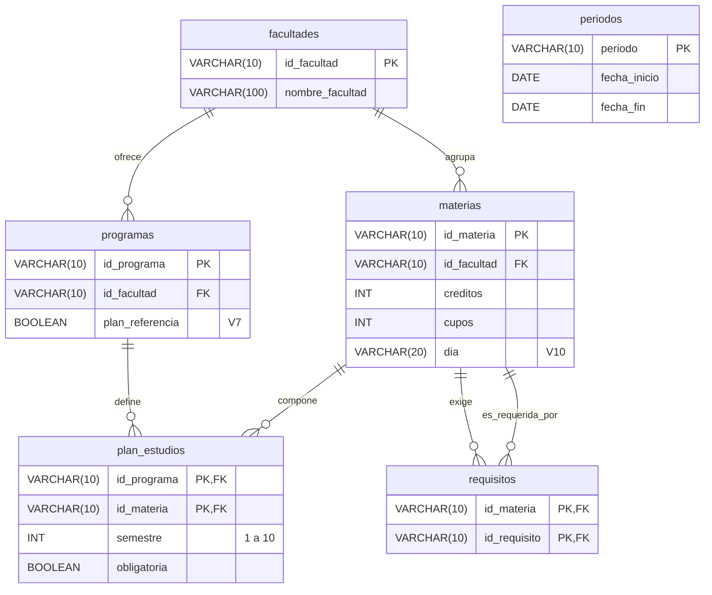

# Modelo de datos en Mermaid

Fuente unica: las migraciones `backend/migrations/V1..V10` aplicadas en orden. No se uso el ERD de pgAdmin ni ninguna otra fuente: si una tabla, columna o llave no aparece en las migraciones, no esta aqui.

**Verificacion del conteo:** las migraciones definen **14 tablas**: las 8 de V1 (`facultades`, `programas`, `profesores`, `materias`, `estudiantes`, `matriculas`, `notas`, `usuarios`), `periodos` (V3), `tareas` y `entregas` (V4), `plan_estudios` (V7), `requisitos` (V8) y `matriculas_lote` (V9). Si un ERD dibujado a mano muestra 12, le faltan dos de las agregadas despues de V1 (revisa `periodos`, `tareas`/`entregas`, `plan_estudios`, `requisitos` y `matriculas_lote`).

---

## 1. Diagrama completo

```mermaid
erDiagram
    facultades {
        VARCHAR(10) id_facultad PK
        VARCHAR(100) nombre_facultad "NOT NULL"
    }
    programas {
        VARCHAR(10) id_programa PK
        VARCHAR(100) nombre_programa "NOT NULL"
        VARCHAR(10) id_facultad FK "NOT NULL"
        BOOLEAN plan_referencia "V7, NOT NULL DEFAULT TRUE"
    }
    profesores {
        VARCHAR(20) id_profesor PK
        VARCHAR(60) nombre "NOT NULL"
        VARCHAR(60) apellidos "NOT NULL"
    }
    materias {
        VARCHAR(10) id_materia PK
        VARCHAR(100) nombre_curso "NOT NULL"
        INT creditos "NOT NULL, CHECK mayor que 0"
        INT cupos "NOT NULL, DEFAULT 20"
        VARCHAR(10) id_facultad FK "NOT NULL"
        VARCHAR(100) horario "nullable, texto libre"
        VARCHAR(20) id_profesor FK "nullable"
        VARCHAR(20) dia "V10, nullable"
        TIME hora_inicio "V10, nullable"
        TIME hora_fin "V10, nullable"
    }
    estudiantes {
        VARCHAR(20) id_estudiante PK "es la cedula"
        VARCHAR(60) nombre "NOT NULL"
        VARCHAR(60) apellidos "NOT NULL"
        VARCHAR(100) correo "NOT NULL"
        VARCHAR(20) telefono "nullable"
        INT semestre "NOT NULL, CHECK mayor que 0"
        VARCHAR(10) id_programa FK "NOT NULL"
    }
    periodos {
        VARCHAR(10) periodo PK
        DATE fecha_inicio "NOT NULL"
        DATE fecha_fin "NOT NULL, CHECK inicio no despues de fin"
    }
    matriculas_lote {
        VARCHAR(20) id_lote PK
        VARCHAR(8) radicado "NOT NULL UNIQUE, 8 caracteres en mayusculas"
        VARCHAR(20) cedula FK "NOT NULL"
        VARCHAR(10) periodo FK "NOT NULL"
        TIMESTAMP fecha "NOT NULL DEFAULT NOW()"
        VARCHAR(20) estado "NOT NULL DEFAULT Activa"
    }
    matriculas {
        VARCHAR(20) id_matricula PK
        VARCHAR(20) cedula FK "NOT NULL"
        VARCHAR(10) id_materia FK "NOT NULL"
        INT creditos "NOT NULL, CHECK mayor que 0"
        VARCHAR(10) periodo "NOT NULL"
        DATE fecha_matricula "NOT NULL DEFAULT CURRENT_DATE"
        VARCHAR(20) estado "NOT NULL DEFAULT Activa"
        VARCHAR(20) id_lote FK "nullable, V9"
    }
    notas {
        VARCHAR(20) id_nota PK
        VARCHAR(20) id_matricula FK "NOT NULL"
        VARCHAR(10) id_materia FK "NOT NULL"
        NUMERIC(3,2) nota1 "nullable, CHECK 0 a 5"
        NUMERIC(3,2) nota2 "nullable, CHECK 0 a 5"
        NUMERIC(3,2) nota3 "nullable, CHECK 0 a 5"
        NUMERIC(3,2) definitiva "nullable, CHECK 0 a 5"
        VARCHAR(20) estado "nullable"
    }
    usuarios {
        SERIAL id_usuario PK
        VARCHAR(30) usuario "NOT NULL UNIQUE"
        VARCHAR(64) sal "NOT NULL"
        VARCHAR(128) password_hash "NOT NULL"
        VARCHAR(20) rol "NOT NULL, CHECK Administrador, Profesor o Estudiante"
        VARCHAR(20) id_persona "nullable, cedula o id de profesor, SIN llave foranea"
        BOOLEAN debe_cambiar_clave "NOT NULL DEFAULT TRUE"
    }
    plan_estudios {
        VARCHAR(10) id_programa PK, FK
        VARCHAR(10) id_materia PK, FK
        INT semestre "NOT NULL, CHECK 1 a 10"
        BOOLEAN obligatoria "NOT NULL DEFAULT TRUE"
    }
    requisitos {
        VARCHAR(10) id_materia PK, FK
        VARCHAR(10) id_requisito PK, FK "CHECK distinto de id_materia"
    }
    tareas {
        VARCHAR(20) id_tarea PK
        VARCHAR(10) id_materia FK "NOT NULL"
        VARCHAR(120) titulo "NOT NULL"
        TEXT descripcion "NOT NULL"
        TIMESTAMP fecha_limite "NOT NULL"
        VARCHAR(255) archivo_apoyo "nullable"
        VARCHAR(20) creada_por FK "nullable"
        TIMESTAMP creada_en "NOT NULL DEFAULT NOW()"
        VARCHAR(20) tipo "V5, NOT NULL DEFAULT taller"
        SMALLINT momento "V6, nullable, CHECK 1 a 3"
    }
    entregas {
        VARCHAR(20) id_entrega PK
        VARCHAR(20) id_tarea FK "NOT NULL"
        VARCHAR(20) cedula FK "NOT NULL"
        VARCHAR(255) archivo "NOT NULL"
        TEXT comentario "nullable"
        TIMESTAMP subida_en "NOT NULL DEFAULT NOW()"
        NUMERIC(3,2) calificacion "V5, nullable, CHECK 0 a 5"
    }

    facultades ||--o{ programas : ofrece
    facultades ||--o{ materias : agrupa
    profesores |o--o{ materias : dicta
    programas ||--o{ estudiantes : inscribe
    estudiantes ||--o{ matriculas : cursa
    materias ||--o{ matriculas : se_matricula_en
    matriculas ||--o{ notas : se_califica_con
    materias ||--o{ notas : nota_de
    materias ||--o{ tareas : genera
    profesores |o--o{ tareas : crea
    tareas ||--o{ entregas : recibe
    estudiantes ||--o{ entregas : sube
    programas ||--o{ plan_estudios : define
    materias ||--o{ plan_estudios : compone
    materias ||--o{ requisitos : exige
    materias ||--o{ requisitos : es_requerida_por
    estudiantes ||--o{ matriculas_lote : radica
    periodos ||--o{ matriculas_lote : agrupa
    matriculas_lote |o--o{ matriculas : contiene
```

Notas del diagrama:

- `usuarios` no tiene llaves foraneas en las migraciones: `id_persona` es un `VARCHAR(20)` simple (la cedula del estudiante o el ID del profesor, `NULL` para admin) sin `REFERENCES`. Por eso no aparece relacionada.
- `matriculas ||--o{ notas`: el DDL permite varias notas por matricula; la regla de "una sola nota por matricula" la enforce la API (`409` en `POST /notas/`), no la base.
- `matriculas` tiene `UNIQUE (cedula, id_materia, periodo)`: no se puede repetir la misma materia en el mismo periodo.

## 2. Relaciones en texto

Las 19 llaves foraneas del esquema final, tal como estan en las migraciones:

| # | Tabla origen | Columna | Tabla destino | Columna | Obligatoria |
|---|---|---|---|---|---|
| 1 | `programas` | `id_facultad` | `facultades` | `id_facultad` | Si (NOT NULL) |
| 2 | `materias` | `id_facultad` | `facultades` | `id_facultad` | Si (NOT NULL) |
| 3 | `materias` | `id_profesor` | `profesores` | `id_profesor` | No (nullable) |
| 4 | `estudiantes` | `id_programa` | `programas` | `id_programa` | Si (NOT NULL) |
| 5 | `matriculas` | `cedula` | `estudiantes` | `id_estudiante` | Si (NOT NULL) |
| 6 | `matriculas` | `id_materia` | `materias` | `id_materia` | Si (NOT NULL) |
| 7 | `matriculas` | `id_lote` | `matriculas_lote` | `id_lote` | No (nullable, V9) |
| 8 | `notas` | `id_matricula` | `matriculas` | `id_matricula` | Si (NOT NULL) |
| 9 | `notas` | `id_materia` | `materias` | `id_materia` | Si (NOT NULL) |
| 10 | `tareas` | `id_materia` | `materias` | `id_materia` | Si (NOT NULL) |
| 11 | `tareas` | `creada_por` | `profesores` | `id_profesor` | No (nullable) |
| 12 | `entregas` | `id_tarea` | `tareas` | `id_tarea` | Si (NOT NULL) |
| 13 | `entregas` | `cedula` | `estudiantes` | `id_estudiante` | Si (NOT NULL) |
| 14 | `plan_estudios` | `id_programa` | `programas` | `id_programa` | Si (NOT NULL) |
| 15 | `plan_estudios` | `id_materia` | `materias` | `id_materia` | Si (NOT NULL) |
| 16 | `requisitos` | `id_materia` | `materias` | `id_materia` | Si (NOT NULL) |
| 17 | `requisitos` | `id_requisito` | `materias` | `id_materia` | Si (NOT NULL) |
| 18 | `matriculas_lote` | `cedula` | `estudiantes` | `id_estudiante` | Si (NOT NULL) |
| 19 | `matriculas_lote` | `periodo` | `periodos` | `periodo` | Si (NOT NULL) |

`plan_estudios` y `requisitos` usan llave primaria compuesta de dos columnas, y ambas columnas son ademas foraneas.

## 3. Diagramas de lectura por dominio

Derivados del diagrama completo, con columnas resumidas (solo PK, FK y las mas relevantes). No reemplazan el diagrama general.

### 3.1 Dominio academico



`periodos` no tiene llaves foraneas; entra en este dominio porque define la ventana academica. La materia que exige un requisito y la materia requerida son ambas `materias` (auto-relacion via `requisitos`).

### 3.2 Dominio de matricula

```mermaid
erDiagram
    estudiantes {
        VARCHAR(20) id_estudiante PK "la cedula"
        VARCHAR(10) id_programa FK
    }
    matriculas_lote {
        VARCHAR(20) id_lote PK
        VARCHAR(8) radicado "UNIQUE"
        VARCHAR(20) cedula FK
        VARCHAR(10) periodo FK
    }
    matriculas {
        VARCHAR(20) id_matricula PK
        VARCHAR(20) cedula FK
        VARCHAR(10) id_materia FK
        VARCHAR(10) periodo
        VARCHAR(20) id_lote FK "nullable"
    }
    notas {
        VARCHAR(20) id_nota PK
        VARCHAR(20) id_matricula FK
        NUMERIC(3,2) definitiva "0 a 5"
    }
    materias {
        VARCHAR(10) id_materia PK
        INT creditos
    }
    periodos {
        VARCHAR(10) periodo PK
    }

    estudiantes ||--o{ matriculas : cursa
    materias ||--o{ matriculas : se_matricula_en
    matriculas ||--o{ notas : se_califica_con
    estudiantes ||--o{ matriculas_lote : radica
    periodos ||--o{ matriculas_lote : agrupa
    matriculas_lote |o--o{ matriculas : contiene
```

`materias` y `periodos` se incluyen solo como referencia externa del dominio (sus atributos completos estan en el diagrama general).

### 3.3 Dominio de tareas

```mermaid
erDiagram
    profesores {
        VARCHAR(20) id_profesor PK
    }
    materias {
        VARCHAR(10) id_materia PK
        VARCHAR(10) id_facultad FK
    }
    tareas {
        VARCHAR(20) id_tarea PK
        VARCHAR(10) id_materia FK
        VARCHAR(20) creada_por FK "nullable"
        VARCHAR(20) tipo "V5"
        SMALLINT momento "V6, 1 a 3"
    }
    entregas {
        VARCHAR(20) id_entrega PK
        VARCHAR(20) id_tarea FK
        VARCHAR(20) cedula FK
        NUMERIC(3,2) calificacion "V5, 0 a 5"
    }
    estudiantes {
        VARCHAR(20) id_estudiante PK "la cedula"
    }

    materias ||--o{ tareas : genera
    profesores |o--o{ tareas : crea
    tareas ||--o{ entregas : recibe
    estudiantes ||--o{ entregas : sube
```

`estudiantes` se incluye como referencia externa (`entregas.cedula`); el archivo de cada entrega vive en `backend/archivos/`, fuera de la base.

## 4. Que agregan V7, V8, V9 y V10

| Migracion | Tablas nuevas | Cambios en tablas existentes |
|---|---|---|
| `V7__plan_estudios.sql` | `plan_estudios` (PK compuesta `id_programa` + `id_materia`, `semestre` 1-10, `obligatoria`) | `programas.plan_referencia BOOLEAN NOT NULL DEFAULT TRUE` |
| `V8__requisitos.sql` | `requisitos` (PK compuesta `id_materia` + `id_requisito`, `CHECK` de no auto-requisito) | ninguna |
| `V9__matricula_cabecera.sql` | `matriculas_lote` (radicado `VARCHAR(8)` UNIQUE en mayusculas, cedula, periodo, fecha, estado) | `matriculas.id_lote VARCHAR(20) REFERENCES matriculas_lote(id_lote)`, nullable para no romper matriculas anteriores |
| `V10__horario_materias.sql` | ninguna | `materias.dia VARCHAR(20)`, `materias.hora_inicio TIME`, `materias.hora_fin TIME`, las tres nullable |

Para completitud, el diagrama general tambien refleja dos migraciones anteriores que solo agregan columnas: `V5` (`tareas.tipo` con CHECK de taller/quiz/examen/trabajo y `entregas.calificacion NUMERIC(3,2)`) y `V6` (`tareas.momento SMALLINT` con CHECK 1 a 3).
